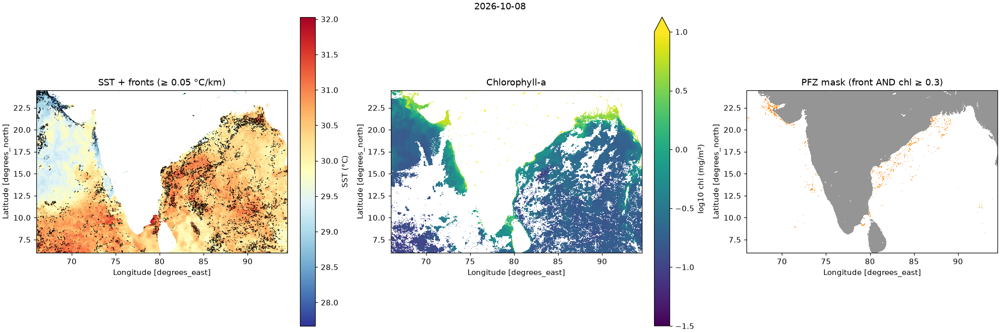
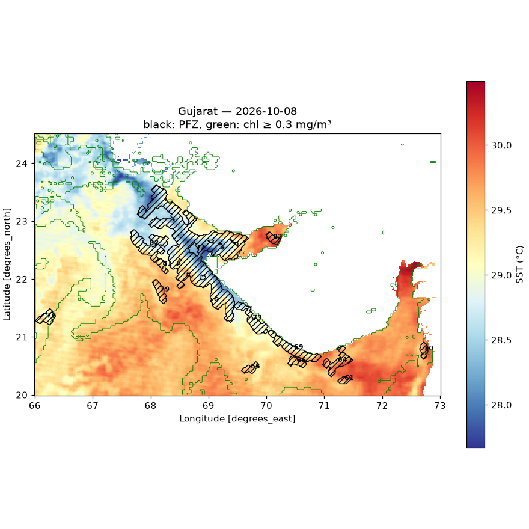
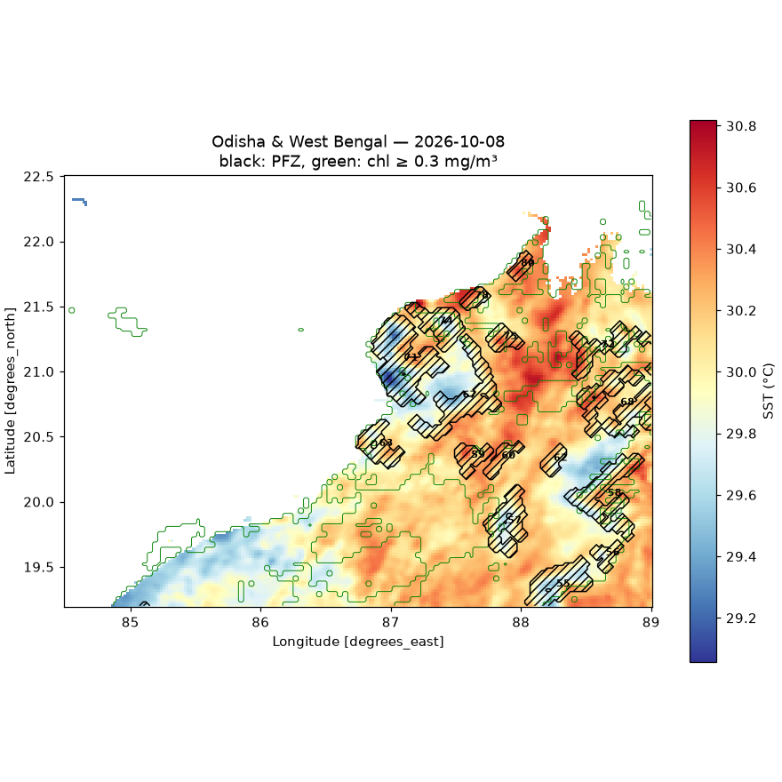

# India PFZ Zoning

Potential Fishing Zone (PFZ) mapping for the coasts of India using free satellite ocean data from NOAA ERDDAP.

## Idea

Fish gather where cold, nutrient-rich water meets warmer water (thermal fronts) and where phytoplankton is abundant. This project:

1. Downloads sea surface temperature (SST) and chlorophyll-a for Indian coastal waters.
2. Finds SST fronts from the temperature gradient.
3. Keeps fronts that overlap productive (high chlorophyll) water.
4. Labels the resulting zones by coastal region and exports maps and GeoJSON.

## Data sources

| Variable | ERDDAP dataset | Resolution | Cadence |
|---|---|---|---|
| SST | `jplMURSST41` (MUR SST v4.1) | 0.01° | Daily |
| Chlorophyll-a | `noaacwN20VIIRSchlaWeekly` (NOAA-20 VIIRS, near real time) | ~0.0375° | 7-day composite, new date daily |

Servers: https://coastwatch.pfeg.noaa.gov/erddap/ (SST) and https://coastwatch.noaa.gov/erddap/ (chlorophyll), no login required

Depth at each zone centroid comes from ETOPO1 (`etopo180` on the same SST server).

Harbour names come from the Department of Fisheries *Handbook on Fisheries Statistics 2020* (Tables 13.2 and 13.3: major harbours and commissioned fishing harbours; Lakshadweep landing centres). Coordinates come from OpenStreetMap via Nominatim (© OpenStreetMap contributors, ODbL). Agro, Dholai, Pazhayar, Roychowk and Petuaghat are left out because they could not be located reliably. Bearing and distance are straight-line from the harbour to the zone centroid.

Zones are clipped to India's EEZ (`india_eez.geojson`, outer boundaries of the mainland + Lakshadweep and Andaman & Nicobar EEZs) from [Marine Regions](https://www.marineregions.org), licensed CC-BY 4.0.

## Coastal regions

| Region | Coast |
|---|---|
| Gujarat | West |
| Maharashtra & Goa | West |
| Karnataka & Kerala | West |
| Lakshadweep | Arabian Sea islands |
| Tamil Nadu & Puducherry | East |
| Andhra Pradesh | East |
| Odisha & West Bengal | East |
| Andaman & Nicobar | Bay of Bengal islands |

## Layout

```
india-pfz-zoning/
├── regions.py     # coastal region bounding boxes
├── fetch.py       # download SST and chlorophyll from ERDDAP
├── pfz.py         # front detection + chlorophyll filter -> zones
├── run.py         # batch runner: SST date + newest chlorophyll on or before it
├── harbours.py    # fishing harbour coordinates for advisory text
├── web/index.html # Leaflet map page reading outputs/
├── site.py        # builds docs/site/ (latest 8 weeks + map page)
├── incois.py      # archives the current INCOIS PFZ lines to validation/incois/
├── validate.py    # compares our zones with an archived INCOIS day
├── sweep.py       # threshold sweep scored against archived INCOIS days
└── outputs/       # per-date maps (PNG), zones.csv, points.csv, zones.geojson
```

## Usage

```
uv run run.py last
```

runs the newest SST day with the newest chlorophyll composite on or before it (chlorophyll is usually 4–10 days behind SST). Outputs go to `outputs/<SST date>/`, and `outputs/index.json` lists every date with its SST date, chlorophyll date and zone counts per region.

For a range, every 7th SST day counting back from the end date:

```
uv run run.py 2026-09-29 2026-11-17
```

Single steps take both dates: `uv run fetch.py 2026-11-17 2026-11-09`, then `uv run pfz.py 2026-11-17 2026-11-09`.

Outputs in `outputs/<date>/`:
- `check.png`: whole-India SST fronts, chlorophyll, and PFZ mask
- `<region>.png`: per-region map with numbered zones
- `points.csv`: advisory points, one per ~30 km tile of each zone (at least one per zone), each inside the zone with its own nearest harbour, bearing, distance, depth and advisory text such as `Veraval: SW, 45 km, depth 60 m`
- `zones.csv`: one row per zone (region, rank within region, an interior lat/lon, area_km2, sst, chl, mean front gradient `grad`, front length `front_km`, `strength` = grad × front_km, depth_m, number of points, and the advisory of the point closest to its harbour)
- `zones.geojson`: zone outlines as polygons (with holes) plus the advisory points (`kind: "point"`)
- `sst.png`, `chl.png`: map overlays (no axes, land transparent, rows resampled to Web Mercator) covering the full download box

## Web map

`uv run site.py` copies the latest 8 weeks of outputs, the map page and the EEZ into `docs/site/`. To view it locally:

```
uv run site.py
python -m http.server -d docs/site
```

A weekly GitHub Actions workflow processes the newest SST day, rebuilds `docs/site/`, commits it and deploys it to GitHub Pages.

## Example output (2026-10-08, earlier science-quality chlorophyll)

All of India: SST with fronts outlined (left), chlorophyll-a (middle), and pixels that are both a front and productive water (right).



Gujarat: the largest zone follows the cold upwelling front along the Saurashtra coast and the Gulf of Kutch. Black hatched areas are zones (numbered), green lines enclose chlorophyll ≥ 0.3 mg/m³.



Odisha & West Bengal: zones on the shelf off the Hooghly and Subarnarekha river mouths.



Largest zones that day, from `zones.csv`:

| id | region | lat | lon | area_km2 | sst (°C) | chl (mg/m³) |
|---|---|---|---|---|---|---|
| 77 | Gujarat | 22.508 | 68.778 | 13938.8 | 28.75 | 2.575 |
| 52 | Andhra Pradesh | 18.522 | 84.799 | 6895.0 | 29.84 | 0.496 |
| 24 | Andhra Pradesh | 15.049 | 81.209 | 4643.2 | 30.86 | 0.536 |
| 11 | Andhra Pradesh | 13.567 | 80.923 | 3830.7 | 30.42 | 0.488 |
| 27 | Andhra Pradesh | 15.436 | 80.421 | 2919.4 | 30.50 | 0.841 |

## Status

Phase 1 of [PLAN.md](PLAN.md) is done. Phase 2 milestones 1–4, 6 and 7 are done: near-real-time chlorophyll, advisory points per zone, and a daily archive of INCOIS PFZ lines (`validation/incois/`, from the WFS layer behind the INCOIS PFZ WebGIS page). `validate.py` compares our zones with an archived day (hit rate of INCOIS line length near our zones, share of our points near INCOIS lines); first result in PLAN.md. Zones are assigned to the region of their nearest harbour. Zone outlines keep their holes. The daily job also scores each archived day against the published zones (`validation/<date>.csv`; `uv run validate.py --summary` averages them per region). Thresholds are set per region in `regions.py`; `sweep.py` scores threshold combinations against the archive (preliminary results in PLAN.md). Next: choose per-region values once ~3 weeks are archived.

## References

- INCOIS PFZ advisory service: https://incois.gov.in
- NOAA CoastWatch ERDDAP: https://coastwatch.pfeg.noaa.gov/erddap/
